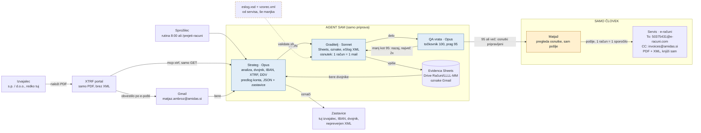

# Diagram rešitve: prejeti računi

Interaktivna različica: https://claude.ai/artifact/QRCjuZoujWbRcEoE9EmK14 (zasebna povezava).

## Potek računa



**Agent ne sme:** pošiljati e-pošte, brisati, plačevati, pisati v XTRF.

## Mesečni ritem

```mermaid
timeline
  title Mesec
  vsak delovni dan ob 8:00 : dnevna rutina : 2 do 5 računov
  12. v mesecu : opomnik : kaj še ni poslano servisu
  16. v mesecu : kontrola : dva dni rezerve
  18. v mesecu : rok servisa : ob vikendu prejšnji delovnik
```

## Odprto
1. eSlog XSD in vzorčni XML od servisa (do takrat osnutki `[XML NEPREVERJEN]`).
2. Ali agent iz Gmaila/XTRF dobi vsebino PDF-ja za priponko (sicer `[PRILOGE ROČNO]`).
3. Potrditev kontov s strani servisa.
